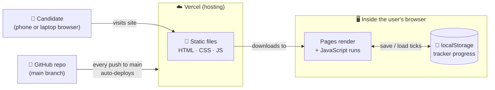
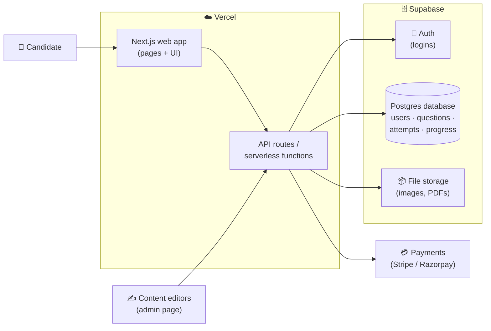

# 02 — Architecture

> **What is this doc?** **Architecture** = how the pieces of a system fit together. Like a building's blueprint: it shows the rooms, the plumbing, and the wiring before anyone lays a brick. We write it down so everyone has the same picture in their head.

## Current architecture (Phase 1: static site)

### The pieces, in plain English

| Piece | What it is | Analogy |
|---|---|---|
| **Static files** | HTML (structure), CSS (looks), JavaScript (behaviour). "Static" means the files are the same for every visitor — no server builds a custom page. | Printed brochures handed to everyone |
| **Data files** (`flashcards.js`, `questions.js`) | Plain JavaScript lists holding our content. To add a question, you edit a list. | A recipe card box |
| **Browser** | Chrome, Safari, etc. It downloads our files and runs the JavaScript on the user's device. | The reader who opens the brochure |
| **localStorage** | A small storage box *inside each user's browser*. We save tracker ticks there. It's private to that browser — if you switch phones, your progress doesn't follow you. | A sticky note on your own fridge |
| **GitHub** | Where the code lives and where we review changes. | The shared office filing cabinet |
| **Vercel** | A hosting company. It watches our GitHub repo and puts the latest `main` branch online automatically. It also makes a **preview link** for every Pull Request. | The print shop that reprints the brochure whenever the master copy changes |

### Why it's built this way
See [ADR 0001](decisions/0001-start-with-static-site.md) and [ADR 0002](decisions/0002-host-on-vercel.md).

### Limitations (on purpose)
- No accounts → progress is per-browser only.
- Content is in code → only people who can edit the repo can add questions.
- No server → we can't hide answers, run timed exams securely, or collect analytics.

These are fine for an MVP. They're exactly what Phases 3–5 fix.

---

## Future architecture (Phases 3–5)

### The new pieces, in plain English

| Piece | What it does | Analogy |
|---|---|---|
| **Frontend (Next.js)** | The part users see. Next.js is a popular framework built on React that makes multi-page apps easier and works perfectly on Vercel. | The shop floor |
| **Backend / API** | Code that runs on a server, not in the user's browser. It checks who you are, fetches questions, saves your answers. **API** = a menu of requests the frontend is allowed to make ("give me 20 Ethics questions"). | The kitchen behind the counter |
| **Serverless functions** | Small backend functions Vercel runs only when needed. No server to manage. | A chef who only shows up when an order comes in |
| **Database (Postgres)** | Organised long-term storage for users, questions, and every answer attempt. | A giant, well-labelled filing cabinet |
| **Auth** | "Authentication" — logging in and proving who you are (email, Google login). | The ID check at the door |
| **Question bank** | Thousands of questions in the database, tagged by topic, difficulty, and learning outcome. Editors add them via an admin page, no code needed. | The library's catalogue |
| **Payments** | Charging for premium features. | The cash register |

### Recommended tech choices

| Need | Recommendation | Why (one line) |
|---|---|---|
| Frontend framework | **Next.js** (React) | Most popular, huge community, made by Vercel so deploys are effortless. |
| Language | **TypeScript** | JavaScript with type checking — catches mistakes before users do. |
| Hosting | **Vercel** | Already using it; same workflow, adds serverless functions. |
| Database | **Supabase (Postgres)** | Real Postgres database with a generous free tier and a friendly dashboard. |
| Auth | **Supabase Auth** (or Clerk) | Built-in email + Google login; one less service if we already use Supabase. |
| Styling | **Tailwind CSS** | Fast to build consistent, mobile-friendly UI. |
| Payments | **Razorpay** (India) / **Stripe** (global) | Industry standard, handle cards/UPI securely so we never touch card numbers. |
| Analytics | **PostHog** or **Vercel Analytics** | See which features people actually use; free to start. |
| Spaced repetition | **FSRS algorithm** (open-source) | Modern, well-researched scheduling used by Anki. |

### Migration path
We don't rewrite everything at once. Phase 3 moves the existing pages into Next.js and adds login. Phase 4 moves questions from JS files into the database. Each step ships on its own.
